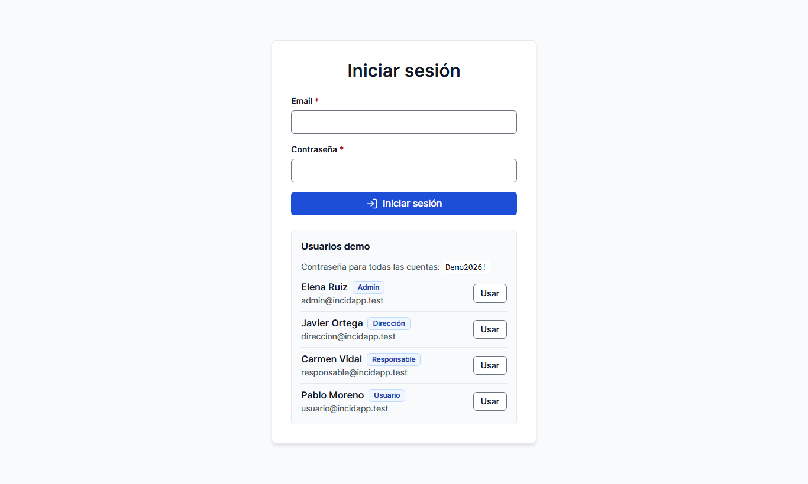
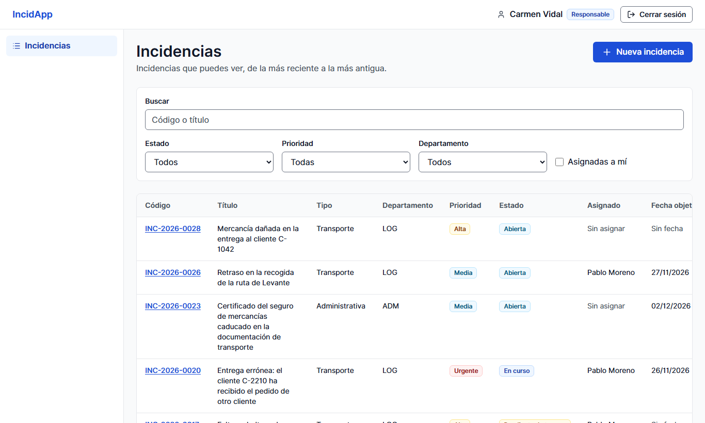
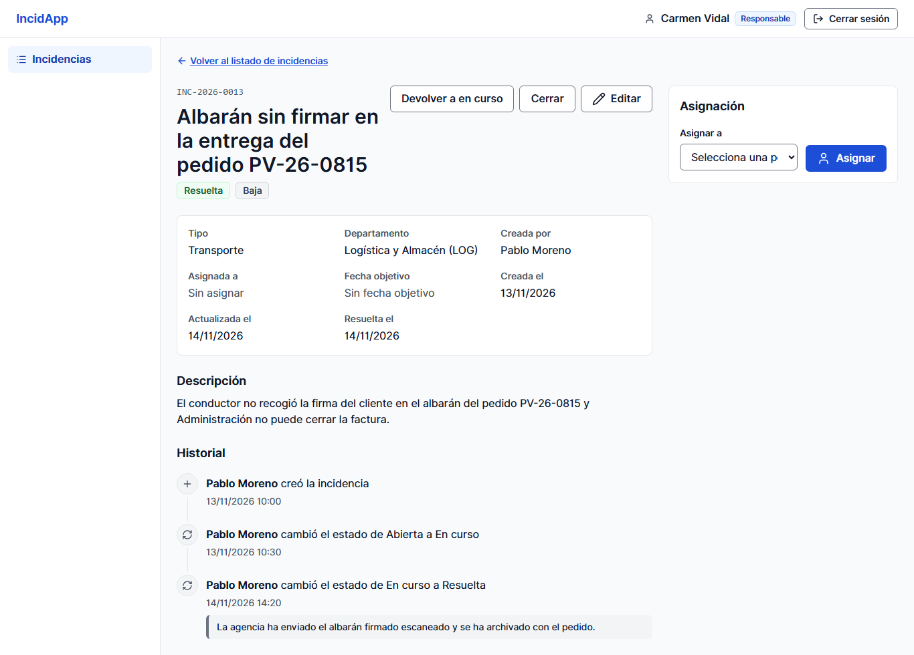
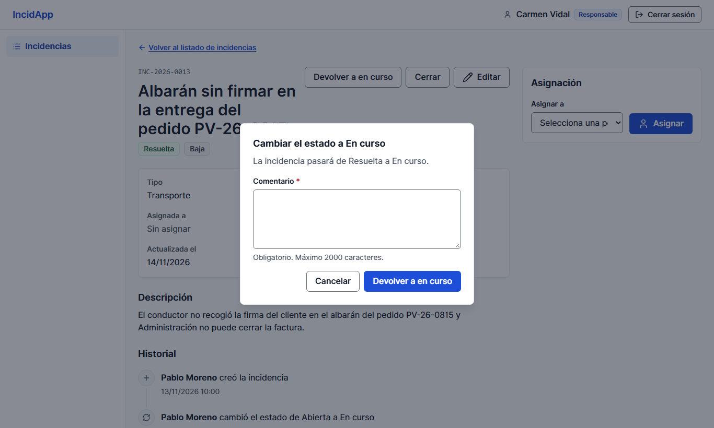
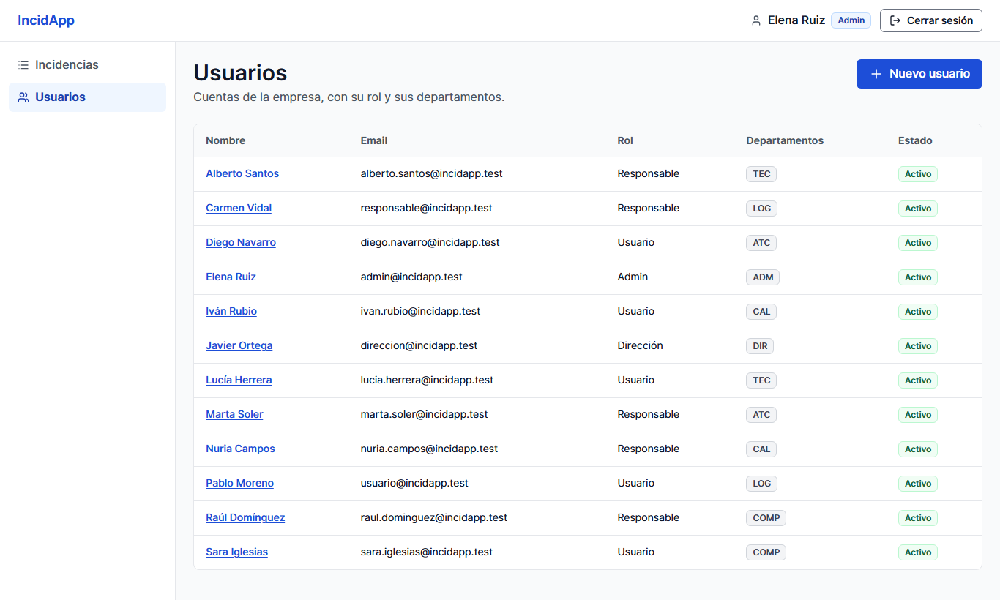
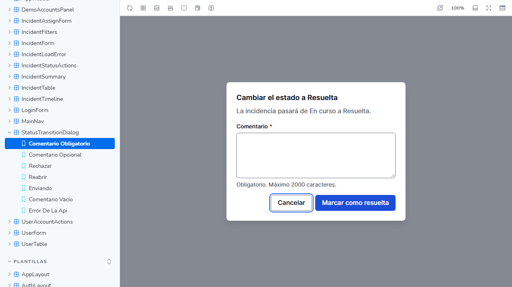

# IncidApp

Aplicación web para registrar y hacer seguimiento de las incidencias de una **empresa ficticia** (transporte, proveedores, clientes, calidad, averías…): cada usuario tiene un rol y uno o varios departamentos, las incidencias reciben un código correlativo, se asignan, pasan por una máquina de estados con **historial inalterable** y el Admin gestiona los usuarios. Lo que cada uno ve y puede hacer lo decide **solo el servidor**.

Trabajo Fin de Máster del *Máster de Desarrollo con IA*, construido con agentes de IA siguiendo *Spec-Driven Development* (ver [Desarrollo con IA](#desarrollo-con-ia)). Todos los datos son **sintéticos**: ninguna empresa, persona ni marca real.

## Enlaces

| | |
|---|---|
| **Demo** | https://incidapp.onrender.com — plan gratuito de Render: si nadie la ha usado en los últimos minutos, **la primera carga tarda alrededor de un minuto** mientras el servicio despierta |
| **Repositorio** | https://github.com/nacho-divetis/incidapp |
| **Slides** | [PDF](https://github.com/nacho-divetis/incidapp/blob/main/slides/incidapp.pdf) (se ve directamente en GitHub) · versión HTML navegable en [`slides/index.html`](slides/index.html) (descárgala y ábrela en el navegador) |
| **Vídeo** | **PENDIENTE (T-07.09):** URL pública del vídeo de la demo · guion en `slides/guion-video.md` |
| **Storybook** | En local: `npm run storybook` → http://localhost:6006 (ver [Arrancar en local](#arrancar-en-local)) |
| **Cómo se aplica el máster** | [docs/master.md](docs/master.md) |

## Usuarios demo

Un usuario por rol, todos con la contraseña **`Demo2026!`**. La pantalla de inicio de sesión los muestra en el recuadro "Usuarios demo": basta con pulsar uno.

| Email | Contraseña | Nombre | Rol | Departamento | Qué probar |
|---|---|---|---|---|---|
| `admin@incidapp.test` | `Demo2026!` | Elena Ruiz | Admin | ADM | Todo, incluida la gestión de usuarios |
| `direccion@incidapp.test` | `Demo2026!` | Javier Ortega | Dirección | DIR | Ve todas las incidencias, sin ninguna acción |
| `responsable@incidapp.test` | `Demo2026!` | Carmen Vidal | Responsable | LOG | Asignar, rechazar, cerrar y reabrir las de Logística |
| `usuario@incidapp.test` | `Demo2026!` | Pablo Moreno | Usuario | LOG | Crear incidencias y trabajar en las suyas y en las asignadas |

La contraseña es pública **a propósito**: la demo solo contiene datos ficticios (dominio reservado `.test` y nombres inventados) y está pensada para que cualquiera la pruebe con cada rol. Por defecto, tras 10 intentos de inicio de sesión desde una misma IP en 15 minutos, la API responde 429 durante un rato (configurable con `LOGIN_RATE_LIMIT_MAX` y `LOGIN_RATE_LIMIT_WINDOW_MS`).

La demo trae **incidencias ficticias** en todos los estados, de todos los tipos y con su historial, para que cada rol tenga algo que ver y que hacer. Para comprobar los permisos: con el Usuario, abre la URL de una incidencia de otro departamento que la API no le deja ver ("Incidencia no encontrada": la API responde 404 y no revela que existe) o `/admin/usuarios` ("No tienes permiso para ver esta página": la API responde 403).

## Funcionalidades

### Inicio de sesión y sesión

Email y contraseña, sesión guardada en el servidor con una cookie `httpOnly`, cierre de sesión y aviso cuando la sesión caduca, con vuelta a la página en la que se estaba.



### Listado de incidencias

Cada usuario ve **solo** las incidencias que le permite la [matriz de permisos](docs/permisos.md): las de sus departamentos, las que ha creado y las que tiene asignadas (Admin y Dirección, todas). Filtros por estado, prioridad, departamento, "Asignadas a mí" y búsqueda por código o título, con paginación.



### Alta, detalle, edición y asignación

- **Alta:** cualquier rol salvo Dirección crea incidencias eligiendo un tipo; el tipo decide el departamento que la recibe y el servidor genera el código `INC-AAAA-NNNN`, correlativo por año.
- **Detalle:** datos, edición y asignación a una persona del departamento propietario, según las **acciones permitidas que devuelve la API** (`allowedActions`): la web no recalcula permisos.
- **Línea de tiempo:** alta, ediciones, asignaciones y cambios de estado con su comentario, en hora de Madrid. El historial es **solo de inserción**.



### Estados

Abierta → En curso (⇄ Pendiente de tercero) → Resuelta → Cerrada, con Rechazada (desde Abierta) y Reabierta (desde Cerrada). Rechazar, resolver, devolver una resuelta a En curso y reabrir **exigen un comentario**. Las transiciones de gestión (rechazar, devolver, cerrar y reabrir) son del Admin y del Responsable; las operativas, también del Usuario que creó la incidencia o la tiene asignada. Diagrama en [docs/diagramas.md](docs/diagramas.md#1--máquina-de-estados-de-una-incidencia-diagrama-de-estados).



### Gestión de usuarios (Admin)

Alta, edición (nombre, rol y departamentos), desactivación y reactivación, y restablecimiento de la contraseña. Desactivar un usuario o restablecer su contraseña cierra sus sesiones abiertas. Los **usuarios demo están protegidos**: solo se puede cambiar su nombre, para que la demo siga funcionando para todos. Para probar la gestión completa, crea usuarios nuevos con un email del dominio `.test`.



### Sistema de diseño

Componentes en *atomic design* (tokens → átomos → moléculas → organismos → plantillas → páginas), cada uno con su *story* en Storybook y comprobados con el addon de accesibilidad.



### Alcance recortado

Por plazo, quedan **fuera del TFM** los adjuntos, la consulta de la auditoría, el cuadro de mando, los comentarios sueltos (solo hay comentario al cambiar de estado), el `Dockerfile`, la CI ampliada y Storybook publicado en GitHub Pages. Están descritos como trabajo futuro en [docs/requisitos.md](docs/requisitos.md#trabajo-futuro). La auditoría **sí** registra los inicios de sesión y los cambios de usuarios.

## Stack

| Parte | Tecnología |
|---|---|
| Monorepo | npm workspaces: `apps/api`, `apps/web`, `packages/shared` |
| API | Node 24, TypeScript, Fastify, Zod · Clean Architecture |
| Base de datos | PostgreSQL con Drizzle ORM · PGlite (PostgreSQL embebido) en local y en tests, Neon en producción |
| Web | React, Vite, React Router, TanStack Query, Tailwind, Radix · atomic design con Storybook |
| Contrato | Esquemas Zod compartidos por la API y la web (`packages/shared`) |
| Seguridad | argon2id, sesión en BD con cookie `httpOnly`/`secure`/`sameSite=Lax`, anti-CSRF, *rate limit*, CSP con Helmet |
| Tests | Vitest, `fastify.inject`, Testing Library, Playwright |
| Calidad | ESLint (con reglas de capas y de niveles atómicos), Prettier, Husky, lint-staged, commitlint, GitHub Actions |
| Despliegue | Render (plan gratuito) + Neon (plan gratuito), definido en `render.yaml` |

## Arquitectura

- **API:** Clean Architecture. `domain` (entidades y máquina de estados, sin dependencias) ← `application` (casos de uso, puertos y `AuthorizationPolicy`) ← `infrastructure` (Drizzle, argon2) y `http` (Fastify) ← `composition` (inyección de dependencias). ESLint impide que una capa importe de una más externa.
- **Web:** atomic design. Solo las páginas usan datos, *router* y sesión; el resto de componentes son presentacionales.
- **Autorización:** se decide solo en el servidor. Un recurso que el usuario no puede ver responde **404**; una acción no permitida sobre uno visible, **403**. Las respuestas incluyen las acciones permitidas y la web muestra u oculta botones a partir de ellas.
- **Un solo servicio:** en producción, la API sirve también la web compilada.

Diagramas UML (estados, capas, niveles y secuencia) en [docs/diagramas.md](docs/diagramas.md) y decisiones en los [ADR](docs/adr/README.md).

## Estructura del proyecto

```
apps/
  api/
    src/domain/          entidades, máquina de estados, código INC-AAAA-NNNN
    src/application/     casos de uso, puertos y AuthorizationPolicy
    src/infrastructure/  Drizzle (esquema, repositorios, UnitOfWork), argon2, reloj
    src/http/            rutas Fastify, sesión, anti-CSRF, errores → HTTP
    src/composition/     configuración, composition root, migrate y seed
    drizzle/             migraciones generadas por drizzle-kit
  web/
    src/app/             router, providers y guardas de ruta
    src/pages/           páginas (las únicas con datos, router y sesión)
    src/components/      atoms/ · molecules/ · organisms/ · templates/
    src/queries/         hooks de TanStack Query
    src/lib/api/         cliente HTTP
    src/styles/          tokens de diseño
    .storybook/          configuración de Storybook
packages/
  shared/src/            contrato: esquemas Zod, tipos y enums
e2e/                     tests E2E con Playwright
docs/
  requisitos.md          requisitos funcionales y no funcionales
  permisos.md            matriz de permisos (fuente de verdad de la autorización)
  diagramas.md           diagramas UML en Mermaid
  adr/                   decisiones de arquitectura
  specs/Fxx-…/           spec.md · plan.md · tasks.md de cada feature
  proceso-ia/            evidencias del desarrollo con IA
  master.md              cómo se aplica cada módulo del máster
render.yaml              Blueprint de Render
```

## Arrancar en local

Requisitos: **Node 24** y npm 11. No hace falta instalar ninguna base de datos ni Docker: en local se usa PGlite y los datos se guardan en `apps/api/.data/`.

```bash
git clone https://github.com/nacho-divetis/incidapp.git
cd incidapp
npm ci
npm run dev          # API en http://localhost:3000 y web en http://localhost:5173
```

`npm run dev` aplica las migraciones y carga los datos demo antes de arrancar, así que se puede entrar enseguida con los [usuarios demo](#usuarios-demo). No hace falta ningún `.env`; las variables opcionales están en [.env.example](.env.example).

Tests y Storybook:

```bash
npm test                          # tests unitarios, de integración y de API (Vitest)
npx playwright install chromium   # solo la primera vez (en Linux: --with-deps chromium)
npm run e2e                       # E2E con Playwright sobre la app compilada y una PGlite temporal
npm run storybook                 # Storybook en http://localhost:6006
```

Si el puerto 5173 está ocupado, Vite usa el siguiente libre (5174…) y lo indica en la consola; la API necesita el 3000 libre.

> Secuencia probada en un clon limpio de `main` el 25/11/2026 en Windows 11 con Node 24.14.0 y npm 11.11.0, sin `.env` ni `DATABASE_URL` (PGlite).

### Comandos

| Comando | Qué hace |
|---|---|
| `npm run dev` | API + web en modo desarrollo (PGlite) |
| `npm run typecheck` | Comprobación de tipos en todos los workspaces |
| `npm run lint` | ESLint, incluidas las reglas de capas (API) y de niveles atómicos (web) |
| `npm test` | Tests de todos los workspaces |
| `npm run e2e` | Tests E2E con Playwright (Chromium) |
| `npm run storybook` | Storybook en local |
| `npm run build-storybook` | Build estático de Storybook |
| `npm run build` | Build de producción |
| `npm start` | Arranca la API compilada, que sirve también la web |
| `npm run db:generate` | Genera una migración a partir del esquema |
| `npm run db:migrate` | Aplica las migraciones |
| `npm run db:seed` | Carga los departamentos, los tipos, los usuarios demo y las incidencias demo (idempotente) |

## Despliegue

Coste cero, con dos servicios gratuitos ([ADR-006](docs/adr/006-despliegue-coste-cero.md)):

- **Render** (*web service* gratuito, Node nativo, Frankfurt): compila la API y la web (`npm ci --include=dev && npm run build`) y arranca con `npm run db:migrate && npm run db:seed && npm start`. El plan gratuito no tiene *pre-deploy* ni disco, así que las migraciones y el *seed* (idempotente) se ejecutan al arrancar.
- **Neon** (PostgreSQL gratuito, Frankfurt): la cadena de conexión se pega en el panel de Render como `DATABASE_URL`, nunca en el repositorio.

Todo está definido en [render.yaml](render.yaml) (Blueprint de Render). Render despliega `main` automáticamente **solo si la CI de GitHub está en verde** (`autoDeployTrigger: checksPass`). Para desplegar una copia: crear un Blueprint en Render apuntando al repositorio, crear una base en Neon y pegar su cadena de conexión en `DATABASE_URL`.

El servicio gratuito se duerme tras unos minutos sin tráfico: la primera petición tarda alrededor de un minuto. `GET /api/health` devuelve el estado de la API y de la base de datos y la versión desplegada.

## Calidad y seguridad

- **CI** en GitHub Actions en cada PR y en cada *push* a `main`: lint, tipos, tests y build ([ci.yml](.github/workflows/ci.yml)), más los E2E en un flujo propio.
- **En cada commit:** Husky ejecuta ESLint y Prettier sobre los archivos cambiados (lint-staged) y commitlint exige Conventional Commits.
- **Tests:** TDD en el dominio y los casos de uso, **matriz completa de autorización** de la API por rol, acción y relación con la incidencia, componentes con Testing Library y flujos E2E. Cifras en [docs/proceso-ia/metricas.md](docs/proceso-ia/metricas.md).
- **Seguridad (OWASP Top 10):** autorización solo en el servidor, contraseñas con argon2id, sesión rotada al iniciar sesión, cabecera anti-CSRF obligatoria, límite de intentos de login, CSP, validación de toda entrada con Zod, historial y auditoría solo de inserción y bloqueo de fila contra condiciones de carrera.

## Desarrollo con IA

La aplicación se ha construido con **Claude Code**: un agente principal que hace de *tech lead* delega cada tarea en un subagente especializado (backend, frontend o QA), verifica el resultado, lanza dos revisores (código y seguridad) **con contexto limpio**, corrige lo que encuentran y hace el commit con el ID de la tarea. Cada feature se especifica antes de programarla (*Spec-Driven Development*: `spec.md` → `plan.md` → `tasks.md`).

- [El harness](docs/proceso-ia/harness.md): subagentes, *skills*, *hooks*, reglas y permisos.
- [Una tarea de punta a punta](docs/proceso-ia/flujo.md): de un criterio de aceptación a producción, con un fallo real que encontraron los revisores.
- [Hallazgos de los revisores](docs/proceso-ia/hallazgos-revisores.md) y [métricas](docs/proceso-ia/metricas.md).

## Cómo se aplica el máster

La tabla de los nueve módulos del máster con la evidencia de cada uno y su enlace está en **[docs/master.md](docs/master.md)**: requisitos y UML, arquitectura y atomic design, IA, herramientas, flujo con IA, calidad, infraestructura y despliegue, seguridad y desarrollo guiado por especificaciones.

## Documentación

- [Requisitos](docs/requisitos.md) · [Matriz de permisos](docs/permisos.md) · [Glosario](docs/glosario.md)
- [Diagramas UML](docs/diagramas.md) · [Decisiones de arquitectura (ADR)](docs/adr/README.md)
- Especificaciones por feature: [F00 Fundaciones](docs/specs/F00-fundaciones/spec.md) · [F01 Autenticación](docs/specs/F01-autenticacion/spec.md) · [F02 Permisos](docs/specs/F02-permisos/spec.md) · [F03 Incidencias](docs/specs/F03-incidencias/spec.md) · [F04 Estados](docs/specs/F04-estados/spec.md) · [F07 Entrega](docs/specs/F07-entrega/spec.md)
- [Cómo se aplica el máster](docs/master.md)
