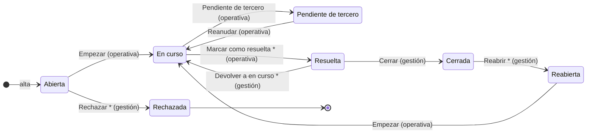
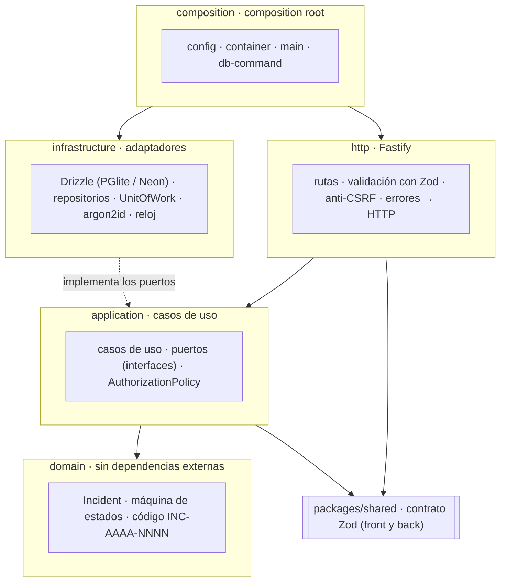
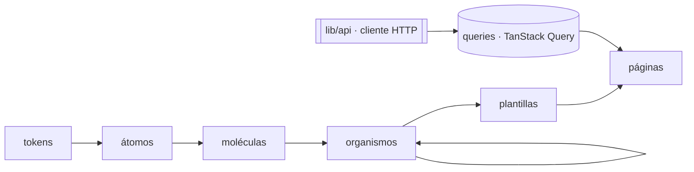
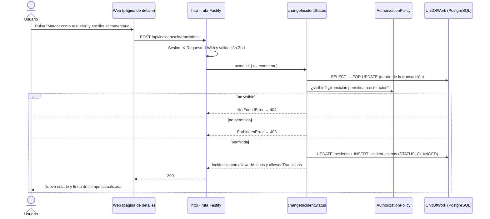

# Diagramas (UML)

Diagramas en [Mermaid](https://mermaid.js.org/), que GitHub dibuja directamente al abrir este archivo. Las reglas de negocio de las que salen están en [`permisos.md`](permisos.md) y las decisiones de arquitectura, en los [ADR](adr/README.md).

## 1 · Máquina de estados de una incidencia (diagrama de estados)

Transiciones de [`permisos.md`](permisos.md#transiciones-de-estado), implementadas en [`status-machine.ts`](../apps/api/src/domain/incidents/status-machine.ts). Las etiquetas son los botones de la web; las marcadas con `*` exigen comentario; las de **gestión** solo las hacen Admin y Responsable (de sus departamentos); las **operativas**, también el Usuario que creó la incidencia o la tiene asignada.

Cada cambio de estado inserta un evento `STATUS_CHANGED` en `incident_events`, que es **solo de inserción**: la línea de tiempo nunca se reescribe.

## 2 · Capas de la API (diagrama de componentes)

Clean Architecture ([ADR-002](adr/002-clean-architecture.md)). Las flechas son dependencias de código: una capa solo importa de las que tiene debajo. La regla la comprueba ESLint (`eslint-plugin-boundaries`, en [`eslint.config.js`](../eslint.config.js)).

- `domain` no importa Fastify, Drizzle, Zod ni `node:*`.
- `http` e `infrastructure` no se importan entre sí: solo el *composition root* las conecta.
- La autorización se decide solo en [`authorization-policy.ts`](../apps/api/src/application/authorization/authorization-policy.ts) ([ADR-009](adr/009-permisos-en-servidor.md)).

## 3 · Niveles de la web (atomic design)

[ADR-008](adr/008-atomic-design-storybook.md). Un nivel solo importa de niveles inferiores; en el mismo nivel, solo los organismos usan otros organismos. Solo las páginas usan datos (TanStack Query), el router y la sesión.

## 4 · Una petición de cambio de estado (diagrama de secuencia)

